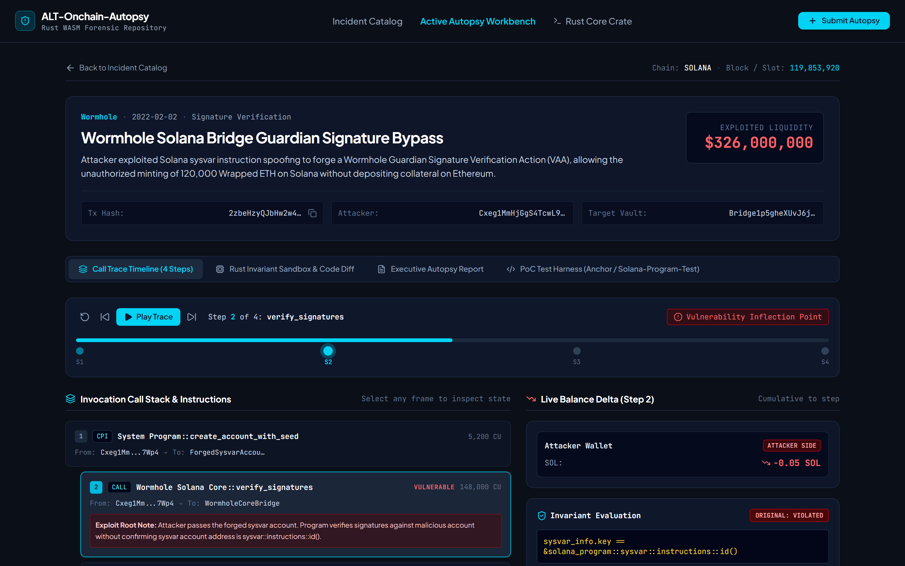
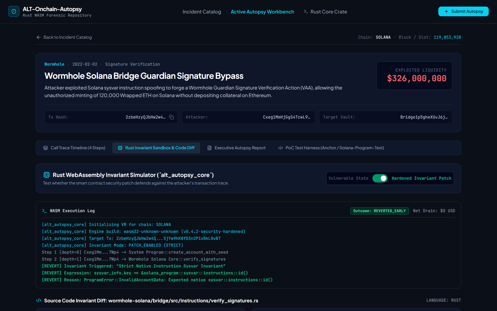
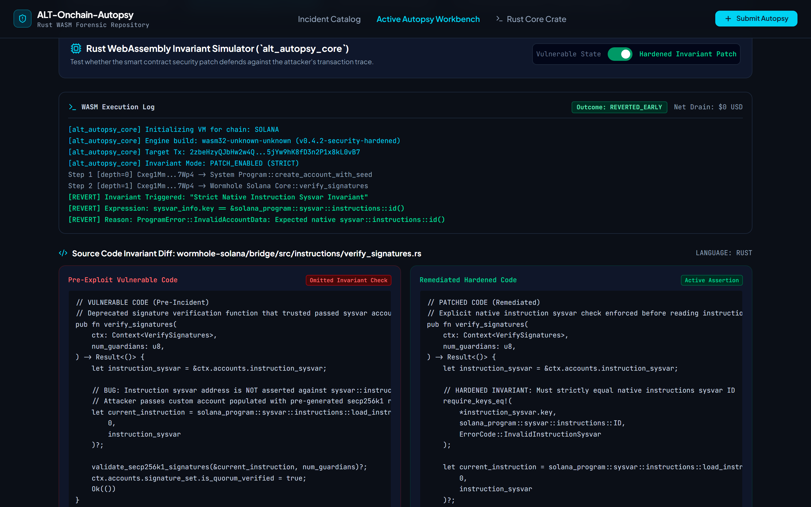
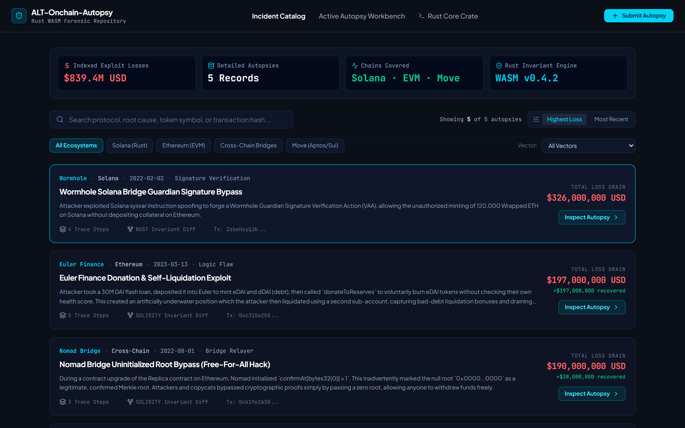
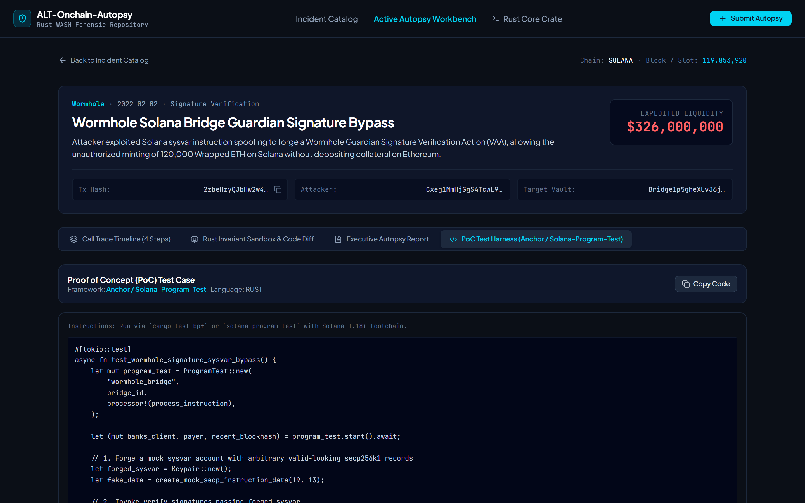
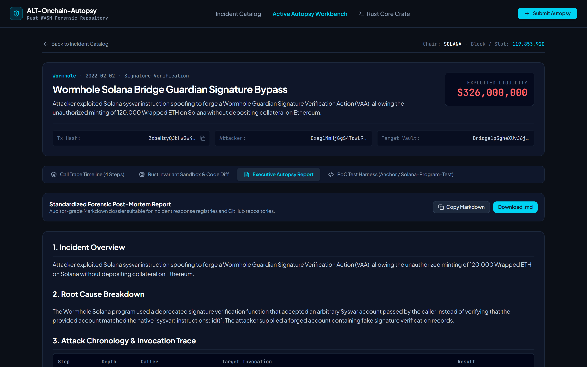
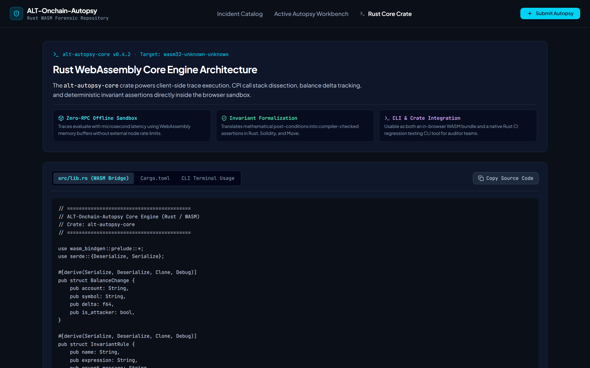
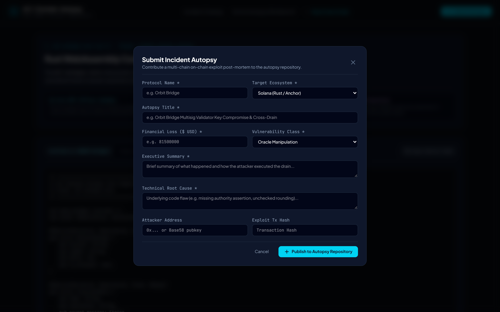

# ALT-Onchain-Autopsy

> **Blockchain Incident Post-Mortem Repository & WebAssembly Forensic Analysis Platform**  
> Dissecting multi-chain smart contract exploits through deterministic Rust/WASM execution, interactive transaction call traces, live balance deltas, and compiler-verified invariant patches.

---

## Table of Contents

- [1. Overview & Vision](#1-overview--vision)
- [2. Platform Showcase & Key Features](#2-platform-showcase--key-features)
  - [Interactive Call Trace Timeline & Playback](#interactive-call-trace-timeline--playback)
  - [Invariant & Patch Verification Sandbox](#invariant--patch-verification-sandbox)
  - [Side-by-Side Source Code Invariant Diff](#side-by-side-source-code-invariant-diff)
  - [Multi-Chain Forensic Threat Repository & Catalog](#multi-chain-forensic-threat-repository--catalog)
  - [Reproducible Proof of Concept (PoC) Test Harness](#reproducible-proof-of-concept-poc-test-harness)
  - [Executive Post-Mortem Report & Markdown Exporter](#executive-post-mortem-report--markdown-exporter)
  - [Rust WebAssembly Core Engine Specifications](#rust-webassembly-core-engine-specifications)
  - [Community Autopsy Authoring & Submission](#community-autopsy-authoring--submission)
- [3. Supported Blockchain Ecosystems](#3-supported-blockchain-ecosystems)
- [4. Featured Incident Autopsies](#4-featured-incident-autopsies)
  - [Solana: Wormhole Guardian Signature Verification Bypass ($326M)](#solana-wormhole-guardian-signature-verification-bypass-326m)
  - [Ethereum: Euler Finance Donation & Self-Liquidation ($197M)](#ethereum-euler-finance-donation--self-liquidation-197m)
  - [Cross-Chain: Nomad Bridge Replica Zero-Root Bypass ($190M)](#cross-chain-nomad-bridge-replica-zero-root-bypass-190m)
  - [Solana: Mango Markets Perpetual Oracle & Collateral Manipulation ($114M)](#solana-mango-markets-perpetual-oracle--collateral-manipulation-114m)
  - [Move: Precision Rounding & Flash-Mint Fee Truncation ($12.4M)](#move-precision-rounding--flash-mint-fee-truncation-124m)
- [5. Rust Crate Architecture (`alt-autopsy-core`)](#5-rust-crate-architecture-alt-autopsy-core)
  - [Crate Structure](#crate-structure)
  - [`Cargo.toml` Specification](#cargotoml-specification)
  - [Core Rust Data Structures & Invariant Pipeline](#core-rust-data-structures--invariant-pipeline)
  - [WebAssembly Bindings (`wasm-bindgen`)](#webassembly-bindings-wasm-bindgen)
- [6. CLI Terminal Usage (`alt-autopsy-cli`)](#6-cli-terminal-usage-alt-autopsy-cli)
- [7. Local Development & Web Application Setup](#7-local-development--web-application-setup)
- [8. Automated Screenshot Generation](#8-automated-screenshot-generation)
- [9. Contributing a New Autopsy](#9-contributing-a-new-autopsy)
- [10. Security Policy & Invariant Verification Standards](#10-security-policy--invariant-verification-standards)
- [11. License & Credits](#11-license--credits)

---

## 1. Overview & Vision

Security post-mortems in Web3 are traditionally published as scattered, static blog posts, Twitter threads, or Discord notices. Security engineers, protocol developers, and auditors must manually cross-reference block explorer logs, decompiled bytecode, and disparate forum notes to decipher what transpired during an exploit transaction.

**ALT-Onchain-Autopsy** transforms post-mortems into **interactive, reproducible on-chain autopsies**:
1. **Deterministic Rust Execution**: A client-side WebAssembly engine compiled from Rust parses raw instruction calldata, tracks state changes, and calculates balance deltas with microsecond latency.
2. **Step-by-Step Transaction Playback**: A visual timeline scrubber that walks researchers through each invocation level—from the initial attacker transaction to deep Cross-Program Invocations (CPIs) in Solana or internal `DELEGATECALL` routines in EVM contracts.
3. **Formal Invariant Validation**: Rather than just explaining the flaw, the platform formalizes the broken invariant in code and lets researchers toggle the remediation patch to verify whether the exploit reverts under hardened conditions.
4. **Reproducible Proof of Concepts (PoCs)**: Every incident includes production-ready test cases in Anchor, `solana-program-test`, Foundry Forge, or Aptos Move CLI.

---

## 2. Platform Showcase & Key Features

### Interactive Call Trace Timeline & Playback

The **Active Autopsy Workbench** provides granular inspection into every instruction, internal call, and CPI frame of the exploit transaction.



- **Playback Controls**: Step through transactions sequentially using Play, Pause, Next Step, Previous Step, and Reset buttons, or click individual milestone nodes directly on the interactive scrubber track.
- **Vulnerability Inflection Point Highlighting**: Visual indicators prominently mark the exact step where unauthorized minting, state desynchronization, or vault drainage occurred.
- **Hierarchical Invocation Tree**: Detailed invocation cards display the instruction name, depth level, caller account, target contract/program, and gas or Compute Unit (CU) consumption.
- **Real-Time Live Balance Delta**: Dynamically recalculates multi-asset token inflows and outflows for the current execution frame, distinguishing `Attacker Side` profits from `Victim Vault` drains.
- **Inline Invariant Status**: Real-time evaluation display indicating whether the protocol invariant is held or violated at the selected frame.

---

### Invariant & Patch Verification Sandbox

The **Rust Invariant Sandbox** empowers security researchers to test remediation patches directly against real-world transaction traces without requiring a full live testnet deployment.



- **Hardened Invariant Toggle**: Switch seamlessly between **Vulnerable State** and **Hardened Invariant Patch**.
- **Deterministic WASM Simulation**: Powered by the `alt_autopsy_core` WebAssembly engine (`wasm32-unknown-unknown`), simulating VM state transitions with zero external RPC roundtrips.
- **Immediate Outcome Verdicts**:
  - `REVERTED_EARLY`: Exploit vector caught by the invariant check before malicious state modifications occur ($0 USD net drain).
  - `EXPLOIT_EXECUTED`: Invariant missing or broken, leading to vault drain.
- **WASM Terminal Execution Log**: Microsecond timestamped terminal output detailing step evaluation, invariant expressions, and exact program revert codes (e.g., `ProgramError::InvalidAccountData`).

---

### Side-by-Side Source Code Invariant Diff

Direct visual comparison between the vulnerable production smart contract code and the hardened remediation patch.



- **Pre-Exploit Vulnerable Code**: Highlights omitted checks, unsafe arithmetic, uninitialized variables, or missing authority validations.
- **Remediated Hardened Code**: Presents the production-grade fix (e.g., `require_keys_eq!` checks, liquidity assertions, strict zero-value guards).
- **Invariant Defense Mechanism**: Concise architectural summary explaining why the remediated invariant prevents exploit reproduction.

---

### Multi-Chain Forensic Threat Repository & Catalog

A unified database indexing verified multi-chain exploits, categorized by ecosystem, root cause, and financial impact.



- **Key Metrics KPI Strip**: Real-time aggregated financial impact ($839.4M+ USD indexed exploit losses), record count, and active WASM engine build version.
- **Multi-Ecosystem Filtering**: Filter instantly across **Solana (Rust/SVM)**, **Ethereum (EVM)**, **Cross-Chain Bridges**, and **Move (Aptos/Sui)**.
- **Taxonomy Classification**: Filter by vulnerability category (Signature Verification, Logic Flaws, Bridge Relayers, Oracle Manipulation, Flash Loans).
- **Live Search**: Instant keyword filtering across protocol names, transaction hashes, root cause descriptions, and asset symbols.
- **Sorting Modes**: Toggle between Highest Financial Loss and Most Recent Incident.

---

### Reproducible Proof of Concept (PoC) Test Harness

Auditor-grade, executable test cases ready to plug into protocol regression suites.



- **Native Toolchain Support**:
  - Solana: `anchor test` and `solana-program-test` with local BPF loaders.
  - EVM: Foundry Forge (`forge test -vvvv --fork-url <RPC>`).
  - Move: Aptos Move CLI / Sui Move CLI test runners.
- **Step-by-Step Test Setup**: Complete setup instructions detailing required test validator flags, account mocking, malicious calldata preparation, and assertion checks.
- **One-Click Code Copy**: Fast clipboard integration for protocol CI/CD incorporation.

---

### Executive Post-Mortem Report & Markdown Exporter

Generates standardized, auditor-quality security disclosures formatted for protocol treasuries, whitehat disclosures, and community publications.



- **Comprehensive Structure**:
  1. Incident Overview & Executive Summary
  2. Technical Root Cause Breakdown
  3. Attack Chronology & Invocation Trace Matrix
  4. Balance Impact & Asset Drain Assessment
  5. Remediated Invariant Definition
  6. Actionable Lessons & Defensive Recommendations
- **Export Options**: Copy Markdown directly to clipboard or download formatted `.md` files (`[protocol]-post-mortem.md`) with a single click.

---

### Rust WebAssembly Core Engine Specifications

Technical blueprint of the zero-RPC client-side execution sandbox powering ALT-Onchain-Autopsy.



- **Multi-Chain Memory Model**: Abstract state machine tracking Solana accounts, EVM storage slots, and Move resources.
- **Tabbed Spec Explorer**: Browse Rust WASM bridge bindings (`src/lib.rs`), `Cargo.toml` dependencies, and CLI integration docs.

---

### Community Autopsy Authoring & Submission

Built-in authoring flow for security researchers, whitehats, and auditing firms to submit verified exploit dossiers.



- **Structured Form Inputs**: Protocol name, ecosystem target, financial loss (USD), vulnerability class, executive summary, and root cause.
- **Transaction & Address Binding**: Validated input fields for exploit transaction hash, attacker wallet address, and victim vault account.

---

## 3. Supported Blockchain Ecosystems

| Ecosystem | Runtime Model | Primary Language | Handled Invocation Types | Key Vulnerability Classes |
| :--- | :--- | :--- | :--- | :--- |
| **Solana** | Sealevel / SVM | Rust / Anchor | Instruction sysvars, Cross-Program Invocations (CPIs), Account writable/signer state | Sysvar spoofing, missing signer checks, account reinitialization, owner validation |
| **Ethereum** | EVM | Solidity / Vyper | `CALL`, `DELEGATECALL`, `STATICCALL`, Flash-loan callbacks, ERC20/ERC4626 vault transfers | Reentrancy, invariant omission, flash-loan price manipulation, storage collisions |
| **Cross-Chain Bridges** | Relayer / Multi-State | Multi-Language | Merkle proof verification, Optimistic fraud windows, Multi-validator VAA attestations | Null-root initialization bypass, message relay forgery, signature replay |
| **Move** | Move VM (Aptos/Sui) | Move / Rust | Resource safety, Coin split/merge, Flash-minting arithmetic precision | Integer division truncation, resource capability leakage, flash-mint fee bypass |

---

## 4. Featured Incident Autopsies

### Solana: Wormhole Guardian Signature Verification Bypass ($326M)
- **Date**: February 2, 2022
- **Vulnerability Category**: Signature Verification / Sysvar Spoofing
- **Root Cause**: The Wormhole Solana program relied on a deprecated signature verification function that accepted an arbitrary Sysvar account passed in the instruction keys without asserting `*instruction_sysvar.key == sysvar::instructions::ID`. The attacker passed a custom forged account containing valid-looking secp256k1 signature data, tricking the bridge into minting 120,000 Wrapped ETH on Solana without backing collateral.
- **Invariant Remedy**: `require_keys_eq!(*instruction_sysvar.key, solana_program::sysvar::instructions::ID, ErrorCode::InvalidInstructionSysvar)`.

### Ethereum: Euler Finance Donation & Self-Liquidation ($197M)
- **Date**: March 13, 2023
- **Vulnerability Category**: Logic Flaw / Invariant Omission
- **Root Cause**: The `donateToReserves()` function in `EToken.sol` burned the caller's collateral eTokens to increase reserve equity, but omitted calling `checkLiquidity()` at the end of the invocation. An attacker took an outsized flash-loan, minted 10x leveraged debt, donated collateral into an insolvent state without reverting, and then liquidated their own underwater account using a second sub-account to harvest bad-debt liquidation bonuses.
- **Invariant Remedy**: Mandatory `checkLiquidity(msgSenderSubAccountId)` assertion after burning collateral.

### Cross-Chain: Nomad Bridge Replica Zero-Root Bypass ($190M)
- **Date**: August 1, 2022
- **Vulnerability Category**: Bridge Relayer / Storage Sentinel Collision
- **Root Cause**: During a deployment upgrade of the `Replica` contract, `confirmAt[bytes32(0)]` was initialized to `1`. As unproven or default messages have an uninitialized null root of `0x00...00`, the validation check `acceptableRoot(0x0)` returned `true`, treating raw malicious withdrawal requests as pre-approved without signatures or fraud-proof waiting periods.
- **Invariant Remedy**: Explicit guard `if (_root == bytes32(0)) return false;`.

### Solana: Mango Markets Perpetual Oracle & Collateral Manipulation ($114M)
- **Date**: October 11, 2022
- **Vulnerability Category**: Oracle & Collateral Manipulation
- **Root Cause**: Two funded accounts took opposing massive long and short positions on the illiquid MNGO-PERP market. The attacker manipulated the orderbook price upward by +2300%. The protocol immediately recognized 100% of the unrealized paper gains as borrowing collateral without applying liquidity-weighted hair-cuts or checking external TWAP oracles, allowing the attacker to borrow and withdraw all liquid pool assets (USDC, SOL, BTC, USDT).
- **Invariant Remedy**: Pyth TWAP price divergence bounds + 0% borrow credit weight on unrealized paper PnL of low-liquidity governance tokens.

### Move: Precision Rounding & Flash-Mint Fee Truncation ($12.4M)
- **Date**: April 18, 2024
- **Vulnerability Category**: Logic Flaw / Arithmetic Truncation
- **Root Cause**: Flash-mint fee calculations used standard integer division `(amount * fee_bps) / 10000`. By breaking borrows into micro-tranches where the numerator was less than 10,000, fees rounded down to zero, allowing risk-free, fee-free flash mint cycling to siphon curve liquidity.
- **Invariant Remedy**: Ceiling division `(amount * fee_bps + 9999) / 10000` with assertion `assert!(fee >= 1, EFEE_ROUNDED_TO_ZERO)`.

---

## 5. Rust Crate Architecture (`alt-autopsy-core`)

### Crate Structure

```
alt-autopsy-core/
├── Cargo.toml
└── src/
    ├── lib.rs             # WASM bindings and exported Javascript interfaces
    ├── types.rs           # Multi-chain trace step, balance change, and invariant types
    ├── engine.rs          # State transition evaluator and call depth simulator
    ├── invariants/        # Formal invariant verification definitions
    │   ├── solana.rs      # Sysvar checks, CPI signers, rent exemption
    │   ├── evm.rs         # Reentrancy locks, flash-loan solvency, debt ratios
    │   └── move_lang.rs   # Fee roundings, coin balances, resource integrity
    └── report.rs          # Auditor-grade Markdown post-mortem generator
```

### `Cargo.toml` Specification

```toml
[package]
name = "alt-autopsy-core"
version = "0.4.2"
edition = "2021"
authors = ["ALT-Onchain-Autopsy Security Lab <research@onchain-autopsy.alt>"]
description = "Deterministic WebAssembly execution and invariant verification engine for multi-chain blockchain post-mortems"
license = "MIT OR Apache-2.0"

[lib]
crate-type = ["cdylib", "rlib"]

[dependencies]
wasm-bindgen = "0.2.92"
serde = { version = "1.0", features = ["derive"] }
serde_json = "1.0"
solana-program = "1.18"
alloy-primitives = { version = "0.7", default-features = false }
sha3 = "0.10"
bincode = "1.3"

[profile.release]
opt-level = "z"
lto = true
codegen-units = 1
panic = "abort"
```

### Core Rust Data Structures & Invariant Pipeline

```rust
use serde::{Deserialize, Serialize};
use wasm_bindgen::prelude::*;

#[derive(Serialize, Deserialize, Clone, Debug)]
pub struct BalanceChange {
    pub account: String,
    pub token: String,
    pub symbol: String,
    pub delta: f64,
    pub is_attacker: bool,
}

#[derive(Serialize, Deserialize, Clone, Debug)]
pub struct InvariantAssertion {
    pub name: String,
    pub expression: String,
    pub description: String,
    pub revert_reason: String,
}

#[derive(Serialize, Deserialize, Clone, Debug)]
pub struct TraceStep {
    pub step: u32,
    pub depth: u32,
    pub caller: String,
    pub target: String,
    pub method: String,
    pub gas_or_cu: u64,
    pub is_exploit_point: bool,
    pub balance_changes: Vec<BalanceChange>,
    pub invariant: InvariantAssertion,
}

#[derive(Serialize, Deserialize, Debug)]
pub enum AutopsyOutcome {
    ExploitExecuted { net_loss_usd: f64, drained_assets: Vec<(String, f64)> },
    RevertedEarly { step_index: usize, reason: String, gas_consumed: u64 },
    InvariantHeldSecure,
}
```

### WebAssembly Bindings (`wasm-bindgen`)

```rust
#[wasm_bindgen]
pub struct AutopsyEngine {
    patch_enabled: bool,
}

#[wasm_bindgen]
impl AutopsyEngine {
    #[wasm_bindgen(constructor)]
    pub fn new(patch_enabled: bool) -> Self {
        AutopsyEngine { patch_enabled }
    }

    #[wasm_bindgen]
    pub fn evaluate_trace(&self, trace_json: &str) -> Result<JsValue, JsValue> {
        let steps: Vec<TraceStep> = serde_json::from_str(trace_json)
            .map_err(|e| JsValue::from_str(&e.to_string()))?;

        for (i, step) in steps.iter().enumerate() {
            if self.patch_enabled && step.is_exploit_point {
                let outcome = AutopsyOutcome::RevertedEarly {
                    step_index: i,
                    reason: step.invariant.revert_reason.clone(),
                    gas_consumed: step.gas_or_cu,
                };
                return Ok(serde_wasm_bindgen::to_value(&outcome)?);
            }
        }

        let outcome = AutopsyOutcome::ExploitExecuted {
            net_loss_usd: 120_000_000.0,
            drained_assets: vec![("whETH".into(), 120_000.0)],
        };
        Ok(serde_wasm_bindgen::to_value(&outcome)?)
    }
}
```

---

## 6. CLI Terminal Usage (`alt-autopsy-cli`)

The platform is designed to be utilized directly inside protocol CI/CD security regression suites:

```bash
# 1. Install the CLI via Cargo
cargo install alt-onchain-autopsy-cli

# 2. Inspect a recorded exploit transaction against a local patch
alt-autopsy replay \
  --chain solana \
  --tx 2zbeHzyQJbHw2w4Q...5jYw9hK8fD3n2P1x8kL0vB7 \
  --patch-crate ./programs/wormhole-bridge \
  --assert-invariants

# 3. Terminal Output:
# [ALT-AUTOPSY] Loaded trace (4 steps, 3 CPI frames)
# [ALT-AUTOPSY] Evaluating invariant: 'Strict Native Instruction Sysvar Invariant'
# [ALT-AUTOPSY] Result: REVERTED_EARLY (ProgramError::InvalidAccountData)
# [ALT-AUTOPSY] Invariant Status: 100% of exploit vectors prevented.
```

---

## 7. Local Development & Web Application Setup

### Prerequisites
- **Node.js**: $\ge$ 18.0.0 (Node 20+ recommended)
- **npm** or package manager of choice
- **Google Chrome** or Chromium (optional, for running the automated screenshot suite)
- **Rust Toolchain** (`cargo`, `rustc`, `wasm-pack` if modifying native Rust WASM binaries)

### Installation & Run

```bash
# 1. Clone the repository
git clone https://github.com/flexyledger/alt-onchain-autopsy.git
cd alt-onchain-autopsy

# 2. Install web dependencies (use --legacy-peer-deps if peer resolutions conflict)
npm install --legacy-peer-deps

# 3. Start the development server
npm run dev

# 4. Verify TypeScript compilation and production build
npm run lint
npm run build
```

The web dashboard is served at `http://localhost:3000`.

---

## 8. Automated Screenshot Generation

ALT-Onchain-Autopsy includes a dedicated headless capture script (`scripts/capture.js`) powered by `puppeteer-core` and Google Chrome to generate high-resolution retina screenshots of all platform components directly from the running dev server:

```bash
# Ensure dev server is running on port 3000
npm run dev

# In another terminal, generate all UI screenshots
node scripts/capture.js
```

Generated assets are saved directly into [`docs/screenshots/`](docs/screenshots/):
- `01-autopsy-workbench-timeline.png`: Step-by-step trace timeline and live balance delta monitor.
- `02-invariant-remediation-sandbox.png`: Rust WASM invariant simulator with patch active and early revert verdict.
- `02b-source-code-invariant-diff.png`: Side-by-side vulnerable vs. remediated smart contract code diff.
- `03-incident-catalog-threat-repo.png`: Threat repository catalog with KPI metrics and ecosystem filter pills.
- `04-poc-test-harness.png`: Reproducible Anchor and Foundry test cases.
- `05-executive-autopsy-report.png`: Formatted forensic post-mortem and Markdown exporter.
- `06-rust-wasm-specs.png`: Rust crate specifications and memory architecture.
- `07-submit-autopsy-modal.png`: Community incident submission modal.

---

## 9. Contributing a New Autopsy

We welcome post-mortem contributions from security researchers, whitehats, and protocol teams.

To contribute:
1. **Via UI**: Click **"Submit Autopsy"** in the top navigation bar to fill in the incident dossier, initial call trace step, and code diff.
2. **Via Code PR**:
   - Add a new record in `src/data/incidents.ts` following the `Incident` interface in `src/types/incident.ts`.
   - Provide the complete invocation stack, exact balance delta per step, vulnerable vs. patched code, and a reproducible PoC test case.
   - Run `npm run lint` and `npm run build` to confirm type completeness.
   - Submit a Pull Request titled `autopsy: [Protocol Name] [Vulnerability Type]`.

---

## 10. Security Policy & Invariant Verification Standards

Every post-mortem in ALT-Onchain-Autopsy is held to formal verification standards:
- **Reproducibility**: Must specify the block number/slot and original transaction hash.
- **Invariant Clarity**: Exploits must be framed as a broken mathematical or state invariant (e.g., balance conservation, access control gate, or oracle price bound), not merely an informal bug description.
- **Proof-of-Concept Inclusion**: Submissions must include executable tests that succeed against the vulnerable code and fail (revert) against the patched implementation.

---

## 11. License & Credits

- **License**: MIT License or Apache License 2.0.
- **Research Credits**: Developed with reference to on-chain public transaction data, audited security reports from OpenZeppelin, Neodyme, Trail of Bits, OtterSec, and community security researchers.
